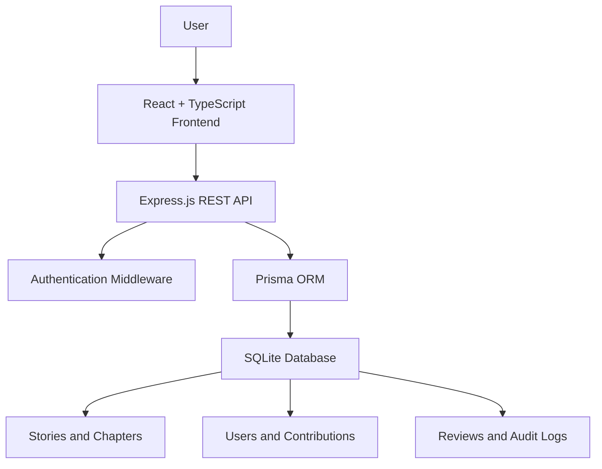

# KathaVerse
### A Living Digital Archive of Kerala's Cultural Heritage

> Bringing Kerala's folklore, mythology, and cultural traditions to life through interactive digital storytelling.

---

## 📖 About the Project

KathaVerse is an interactive digital storytelling platform dedicated to preserving and sharing the rich cultural heritage of Kerala.

The platform brings together folklore, mythology, legends, ritual traditions, and sacred art in an illustrated digital library. Stories are presented in English and Malayalam, making Kerala's cultural narratives accessible to a wider audience.

KathaVerse also encourages community participation by allowing contributors to submit stories that can be reviewed and preserved as part of the growing cultural archive.

## 🎯 Problem Statement

Kerala's rich cultural heritage is preserved through oral traditions, regional narratives, and historical literature. However, many stories remain scattered across sources and may become less accessible to younger generations.

KathaVerse aims to address this challenge by creating a digital platform that:

- Preserves Kerala's traditional stories.
- Makes cultural narratives accessible in English and Malayalam.
- Encourages community-driven storytelling.
- Promotes awareness of Kerala's folklore and traditions.

## ✨ Key Features

- **Digital Story Library:** Explore a collection of Kerala's folklore, mythology, and cultural narratives.
- **Bilingual Storytelling:** Access stories in English and Malayalam.
- **Interactive Reading Experience:** Read illustrated stories and chapters in a digital book-style interface.
- **Story Discovery:** Explore stories through categories, search, and featured collections.
- **Community Contributions:** Submit cultural stories to the archive.
- **Editorial Review:** Support the review and management of submitted stories.
- **User Authentication:** Register and sign in to access contributor functionality.
- **Cultural Documentation:** Preserve regional traditions and narratives for future generations.
- **Responsive Interface:** Designed for an accessible digital reading experience.

## 🛠️ Technology Stack

| Technology | Purpose |
|---|---|
| React | Frontend user interface |
| TypeScript | Type-safe frontend development |
| Vite | Development server and build tool |
| Tailwind CSS | Styling and responsive design |
| Node.js | Backend runtime |
| Express.js | Backend API |
| Prisma ORM | Database management |
| SQLite | Local development database |
| JWT | Authentication |

## 🏗️ System Architecture

KathaVerse follows a frontend-backend architecture.



### Architecture Components

- **Frontend:** React and TypeScript provide the interactive user interface.
- **Backend:** Express.js handles API requests, authentication, and story contributions.
- **Authentication:** JWT-based authentication supports user access.
- **Database:** SQLite stores users, stories, chapters, contributions, reviews, and audit logs.
- **ORM:** Prisma provides database access and management.

## 📂 Project Structure

```text
KathaVerse/
│
├── public/
│   ├── images/
│   └── landing-pages/
│
├── src/
│   ├── components/
│   ├── data/
│   ├── i18n/
│   ├── lib/
│   ├── pages/
│   ├── App.tsx
│   └── main.tsx
│
├── server/
│   ├── auth.js
│   ├── db.js
│   └── index.js
│
├── prisma/
│   ├── schema.prisma
│   └── seed.js
│
├── package.json
├── vite.config.ts
└── README.md
```

## 🚀 Installation and Setup

### Prerequisites

Ensure the following are installed:

- Node.js (version 20 or newer recommended)
- npm
- Git

### Step 1: Clone the Repository

```bash
git clone YOUR_GITHUB_REPOSITORY_URL
```

Navigate to the project directory:

```bash
cd KathaVerse
```

### Step 2: Install Dependencies

```bash
npm install
```

### Step 3: Configure Environment Variables

Create a `.env` file in the root directory.

Add the following configuration:

```env
DATABASE_URL="file:./dev.db"
JWT_SECRET="replace-with-a-secure-secret"
PORT=8787
ADMIN_EMAIL="admin@kathaverse.local"
ADMIN_PASSWORD="replace-with-a-secure-password"
```

**Important:** Keep your `.env` file private. Never upload passwords, secret keys, or other sensitive credentials to GitHub.

### Step 4: Initialize the Database

Run the following command to create the database tables and populate the initial story data:

```bash
npm run db:setup
```

### Step 5: Start the Backend Server

Open a terminal and run:

```bash
npm run server
```

The backend API will run at:

```text
http://localhost:8787
```

### Step 6: Start the Frontend

Open another terminal in the project directory:

```bash
npm run dev
```

Open the local development URL displayed in the terminal, usually:

```text
http://localhost:5173
```

### Step 7: Build for Production

```bash
npm run build
```

## 🌱 Future Enhancements

- Expand the collection of Kerala cultural stories.
- Improve multilingual storytelling and translation quality.
- Introduce audio narration for stories.
- Enhance community participation and editorial workflows.
- Develop additional interactive cultural learning experiences.
- Support deployment with a production-ready database.

## 👥 Team Credits

Developed by **Team KathaVerse**

| Team Member | Contribution |
|---|---|
| Jesbel TS | Project development and implementation |
| Meryl Grace Jiju | Project development and implementation |

We collaboratively developed KathaVerse to preserve and promote the cultural heritage of Kerala through digital storytelling.

## 📜 License

This project is intended for educational and cultural preservation purposes.

This repository is currently distributed without a specified open-source license. A license such as the MIT License may be added after the team confirms the licensing terms.

## ❤️ Acknowledgements

KathaVerse is inspired by the rich cultural heritage of Kerala and the importance of preserving traditional stories, folklore, and cultural knowledge for future generations.

---

### KathaVerse — Where Kerala's stories live on.
